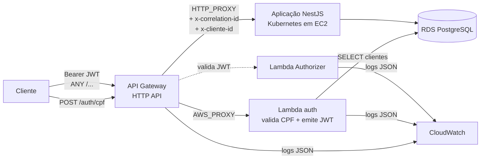
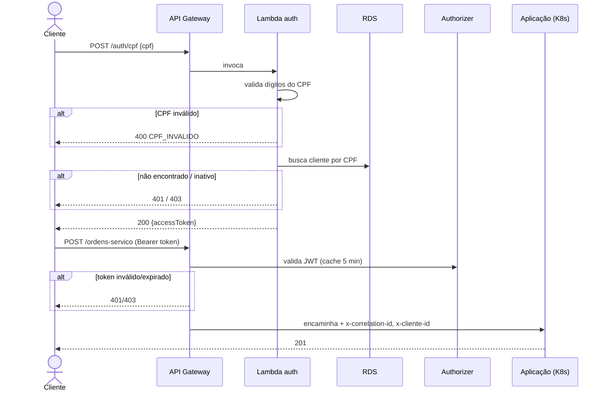

# techChallengePosTech-auth

Repositório **01 – Autenticação e API Gateway** do Tech Challenge 13SOAT, Fase 3 (oficina mecânica).

Contém:
- **Lambda de autenticação:** valida o CPF, consulta o cliente no PostgreSQL (RDS) e emite um JWT.
- **Lambda Authorizer:** valida o JWT nas rotas protegidas.
- **API Gateway (HTTP API):** ponto único de entrada. Faz o roteamento para a Lambda e para a aplicação no Kubernetes.
- **Terraform e GitHub Actions:** provisionamento e deploy automático em homologação e produção.

| Repositório | Responsável |
|---|---|
| [techChallengePosTech-auth](https://github.com/FernandoGreco/techChallengePosTech-auth) (este) | Junior |
| [techChallengePosTech-Aplication](https://github.com/FernandoGreco/techChallengePosTech-Aplication) | Daisy |
| [techChallengePosTech-k8s-infra](https://github.com/FernandoGreco/techChallengePosTech-k8s-infra) | Felipe |
| [techChallengePosTech-db-infra](https://github.com/FernandoGreco/techChallengePosTech-db-infra) | Fernando |

## Arquitetura



### Fluxo de autenticação



Contrato completo (claims, códigos de erro, headers): [`docs/auth-contract.md`](docs/auth-contract.md).

## Tecnologias

- **Linguagem:** Node.js 22 e TypeScript, empacotados com esbuild. É a mesma stack da aplicação.
- **Bibliotecas:** `jsonwebtoken` (HS256) e `pg`.
- **Testes:** Jest.
- **Infraestrutura:** AWS Lambda, API Gateway HTTP API e CloudWatch Logs.
- **IaC:** Terraform 1.10 ou mais novo, com estado em S3 e `use_lockfile`.
- **CI/CD:** GitHub Actions.

## Executar localmente

```bash
npm ci
npm run lint
npm test            # testes unitários (sem banco)
npm run build       # gera dist/auth.js e dist/authorizer.js
```

Para chamar o handler contra um Postgres local (por exemplo, o `docker compose` da aplicação), use as variáveis do [`.env.example`](.env.example).

## Deploy

| Branch | Ambiente | O que roda |
|---|---|---|
| `feature/*`, `feat/*` | — | Lint, testes, build, `terraform validate` |
| PR → `homolog` / `main` | homolog / prod | Tudo acima + `terraform plan` |
| merge em `homolog` | **homolog** | `terraform apply` + smoke test |
| merge em `main` | **prod** | `terraform apply` + smoke test |

Fluxo: `feat/*` → PR para `homolog` (deploy em homolog) → PR de `homolog` para `main` (deploy em prod).
As branches `main` e `homolog` são protegidas: não aceitam push direto e exigem PR aprovado com o CI verde.

### Configuração no GitHub

**Secrets do repositório**, válidos para todos os ambientes:
- **Credenciais do lab:** `AWS_ACCESS_KEY_ID`, `AWS_SECRET_ACCESS_KEY` e `AWS_SESSION_TOKEN`. Ficam em *AWS Academy → AWS Details → AWS CLI*.
- **`TF_STATE_BUCKET`:** o bucket S3 do estado do Terraform. Cada ambiente usa a chave `auth/<ambiente>.tfstate`.

**Environments `homolog` e `prod`:**
- **Secret `DATABASE_URL`:** a connection string do RDS, que vem do repositório db-infra.
- **Secret `JWT_SECRET`:** precisa ser igual ao da aplicação.
- **Variable `APP_BASE_URL`:** o endpoint estável da aplicação, que vem do repositório k8s-infra. Se ficar vazia, só a rota `/auth/cpf` é criada.

> ⚠️ **AWS Academy Learner Lab:** as credenciais expiram a cada sessão (cerca de 4 horas). Depois de clicar em *Start Lab*, atualize os 3 secrets `AWS_*` antes de rodar a pipeline.
>
> O lab também não permite criar roles IAM. Por isso as Lambdas usam a `LabRole`, que já existe na conta (variável `lambda_role_name`).

### Deploy manual

```bash
npm ci && npm run build
cd terraform
terraform init -backend-config="bucket=<bucket>" -backend-config="key=auth/homolog.tfstate" \
               -backend-config="region=us-east-1" -backend-config="use_lockfile=true"
export TF_VAR_database_url=... TF_VAR_jwt_secret=... TF_VAR_app_base_url=...
terraform plan -var-file=environments/homolog.tfvars
```

## Testando a API

```bash
API=$(terraform -chdir=terraform output -raw api_endpoint)

# 1. Autenticar
TOKEN=$(curl -s -X POST "$API/auth/cpf" -H 'content-type: application/json' \
  -d '{"cpf":"123.456.789-09"}' | jq -r .accessToken)

# 2. Rota protegida sem token → 401
curl -i "$API/ordens-servico"

# 3. Rota protegida com token → 200
curl -i "$API/ordens-servico" -H "Authorization: Bearer $TOKEN"
```

O Swagger da aplicação fica disponível pelo gateway em `GET $API/api/docs`.

## Decisões de design

- **Lambda Authorizer em vez do JWT Authorizer nativo:** o authorizer nativo do HTTP API só aceita emissores OIDC com JWKS (RS256). Com HS256 e segredo compartilhado, que é o contrato combinado com a aplicação, a validação precisa ser feita numa Lambda.
- **Lambda em uma conta AWS separada da do banco:**
  - A Lambda e o Gateway rodam na conta AWS Academy do responsável por este repositório. O RDS e o cluster ficam na conta do grupo.
  - Assim os deploys deste repositório não dependem da sessão do lab de outra pessoa.
  - Como o Learner Lab não permite VPC peering entre contas, a Lambda roda **fora de VPC** e conecta no **endpoint público do RDS**, com SSL obrigatório e senha forte.
  - Para rodar na mesma conta do banco, pela rede privada, basta informar `vpc_id` e `subnet_ids` no `tfvars`.
- **Segredos em variáveis de ambiente da Lambda, e não no Secrets Manager:** cada leitura do Secrets Manager custa e adiciona latência, e o orçamento do lab é de US$50. As variáveis ficam criptografadas em repouso com KMS.
- **Consulta compatível com a migration do `ativo`:** a Lambda funciona antes e depois de a coluna ser adicionada em `clientes`.
